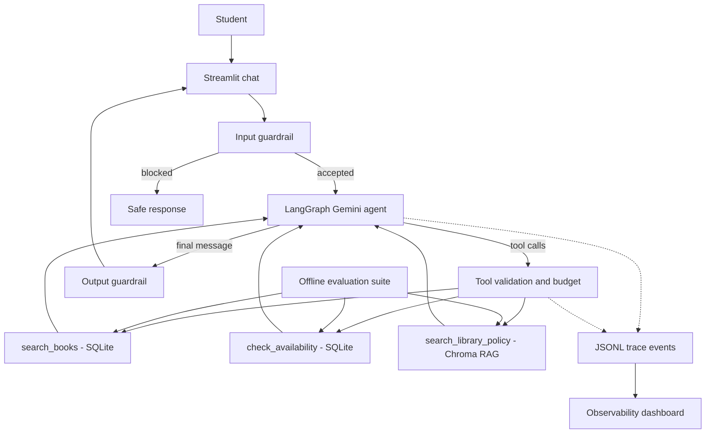
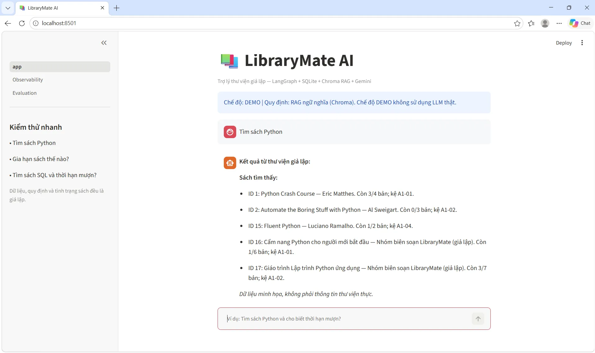

# 📚 LibraryMate AI — Agentic Library Assistant

**Working academic MVP** | Python · Streamlit · LangGraph · Gemini · SQLite · Semantic RAG (ChromaDB)

> **Disclaimer:** This is a university-course prototype. All 150 catalog entries and seven borrowing-policy sections are **fictional**; the app does not connect to any real library or perform real loans.

## Project at a glance

| Item | Implementation |
| --- | --- |
| Interface | Streamlit chat + Observability and Evaluation pages |
| AI orchestration | LangGraph with Gemini tool calling (or clearly labeled rule-based DEMO mode) |
| Knowledge sources | Synthetic SQLite book catalog + bilingual fictional library policies |
| Retrieval | Sentence Transformers + local ChromaDB |
| Safety | Input/tool/output checks, read-only tools, LLM/tool-call budgets |
| Evidence | 30/30 offline evaluations reported by project team; selected trace recorded below |
| Repository | https://github.com/son-hiuming/-LibraryMate-AI |

> **Evidence boundary:** A passing offline evaluation does not demonstrate live Gemini reliability. Live API calls remain subject to model availability and project rate limits.

## What it does

- Search the catalog of 150 example books; check copy availability and shelf location.
- Retrieve fictional library regulations from bilingual policy chunks with **Sentence Transformers** and **ChromaDB**; cite section IDs P01–P07.
- Route questions with **Gemini tool calling through LangGraph**; supports questions that involve multiple tools.
- Apply **input, tool, and output guardrails** plus per-question budgets (3 LLM calls / 5 tool calls / max 3 per tool batch).
- Record structured JSONL events and inspect them in Streamlit **Observability**.
- Execute 30 deterministic **offline evals** without using Gemini API and view reports in **Evaluation**.

## Architecture



The 3 tools are **read-only**. `LIBRARYMATE_MODE=demo` is rule-based simulation, whereas `gemini` uses a real LLM; do not equate them when presenting results.

## Quick start — Windows PowerShell / Python 3.11

```powershell
py -3.11 -m venv .venv
Set-ExecutionPolicy -Scope Process -ExecutionPolicy Bypass
.\.venv\Scripts\Activate.ps1
python -m pip install --upgrade pip
python -m pip install -r requirements.txt
Copy-Item .env.example .env
```

Edit `.env`: to use real LLM tool calling, set `LIBRARYMATE_MODE=gemini`, enter your own `GOOGLE_API_KEY` locally, and choose a Gemini model **available to your project**. To test without API calls, leave `LIBRARYMATE_MODE=demo`. **Never commit or upload `.env`.**

```powershell
python -m scripts.init_db
python -m scripts.build_rag_index
python -m scripts.run_offline_evals
python -m pytest -q
streamlit run app.py
```

Open the local URL Streamlit prints (usually `http://localhost:8501`). RAG index creation can download multilingual embedding weights once; internet is required for that first download.


## Demo Screenshots

### 1. Book Search (DEMO Mode)


### 2. Semantic RAG (DEMO Mode)


### 3. Observability Dashboard


### 4. Offline Evaluation Results


> Note: Book Search and RAG screenshots were captured in DEMO mode. The 30/30 pass rate applies to offline evaluations, not live Gemini accuracy.

## Rebuild after changing data

- `data/books.csv` changed: `python -m scripts.init_db`
- `data/library_policy.md` or embedding model changed: `python -m scripts.build_rag_index --force`

## Evidence and current status 

- **Offline Evals:** the project team ran `python -m scripts.run_offline_evals` and reported **30 passed, 0 failed, 0 errors, 0 skipped**. These tests cover catalog search, stock, RAG and input guardrails. They are *not* 100% real-world answer accuracy.
- **Observability:** a provided local dashboard showed 8 runs, 8 completed successfully, and 0 errors *in that local log set*. One example trace completed in **44.294s**, with **2 Gemini calls** and **1 `search_library_policy` tool call**; RAG retrieval was **36.757s** of the run.
- **Known constraints:** Google API rate limits can prevent a live Gemini demo; Chroma/model initial load can make early requests slow. A passed offline suite is not proof that a live end-to-end request will always succeed.

## Demonstration and screenshots

Screenshots have **not yet been committed**. After capturing images from your own running application, add them under `docs/images/` (see [evidence capture guide](docs/EVIDENCE_GUIDE.md)). Recommended examples:

| Screenshot | What it should prove |
| --- | --- |
| Chat / book search | Book title, available copies, shelf location, and clearly labeled mode |
| Policy RAG answer | An answer grounded in fictional section P03 with source reference |
| Observability timeline | Event sequence and tool/LLM counts for one Run ID |
| Offline evaluation | The terminal output or Evaluation page showing 30 passed, 0 failed |

Do not publish screenshots showing API keys, user-identifying queries, private local paths or unrelated browser tabs. Never represent a DEMO-mode screenshot as a live Gemini tool-calling result.

## Technical decisions and limitations

- **Single-agent design:** One LangGraph agent and three read-only tools keep the course MVP testable and auditable.
- **Two data access patterns:** SQLite supports structured catalog/availability lookups; ChromaDB supports semantic policy retrieval.
- **Offline vs live evaluation:** Offline tests validate deterministic behavior without API quota. They do not measure live answer correctness or tool-selection reliability.
- **Rate limits:** Gemini 3 Flash quota has affected live runs. A rate-limit response is an API constraint rather than evidence of a failed Chroma retrieval.
- **RAG cold start:** The observed example spent 36.757 s in `search_library_policy`; this is an **example trace**, not an average benchmark. Caching model and client initialization is a future optimization.
- **Privacy:** JSONL logs omit question and answer bodies by default; a sudden process stop may leave an incomplete trace.

## Test commands

```powershell
python -m pytest -q
python -m pytest -q tests/test_rag_live.py
python -m scripts.run_offline_evals
```

Offline report: `reports/offline_evals.json` (generated locally and ignored by Git). Logs: `logs/events.jsonl` (also ignored). To inspect run timeline use Streamlit sidebar → **Observability**.

## Repository map

```text
app.py                       Streamlit chat
pages/1_Observability.py    Logs/dashboard
pages/2_Evaluation.py       Offline evaluation viewer
src/agent/graph.py          LangGraph state, nodes, routes, Gemini/demo mode
src/tools/library_tools.py Read-only book and policy tools
src/rag/engine.py           Local embeddings and Chroma retrieval
src/guardrails/rules.py     Guardrail validation
src/monitoring/             Structured run logs and analytics
scripts/                    SQLite, RAG indexing, offline evaluations
data/                       Synthetic catalog and policies
evals/                      Evaluation cases
tests/                      Automated tests
docs/                       Architecture, demo script, hand-in notes
```

## Project submission

This project is published at **[GitHub: son-hiuming/-LibraryMate-AI](https://github.com/son-hiuming/-LibraryMate-AI)**. The submission also requires presentation slides and an introductory/demo video; link those assets here **after they are uploaded and verified**. Do not expose keys, personal logs or generated indexes.

## Limitations & safety

This is an educational demonstration, not a production service. Catalog and policy statements must be sourced from the fictional dataset. Guardrails are baseline rules, not a complete security guarantee; logs omit raw questions and responses by design. The offline evaluation set does not assess live LLM tool-selection accuracy or adversarial robustness across all prompts.
