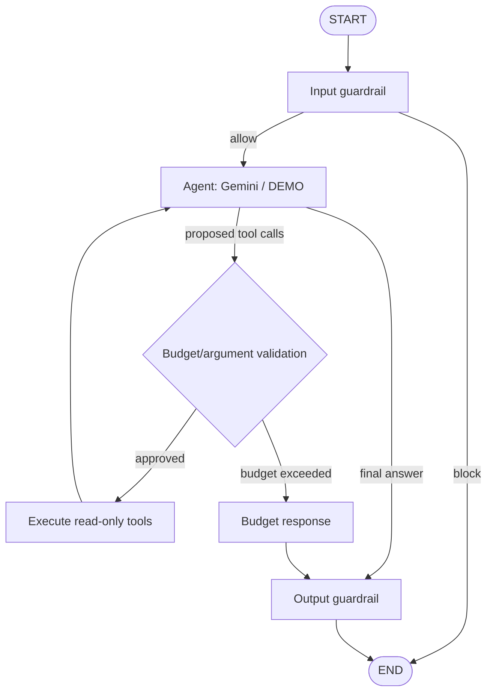

# Architecture & implementation decisions

## Runtime graph

Actual implementation: `src/agent/graph.py`. State keys: `messages`, `run_id`, `steps`, `blocked`, `error`, `tool_count`. `GRAPH=create_graph()` compiles a LangGraph StateGraph. Max `LLM_CALLS=3`, `TOTAL_TOOLS=5`, `TOOLS_PER_TURN=3`.

## Data and retrieval
- `data/books.csv` → `python -m scripts.init_db` → SQLite `data/library.db`.
- `data/library_policy.md` → chunk bilingual P01–P07 → multilingual Sentence Transformers → local persistent ChromaDB → semantic retrieval → policy evidence.
- All catalog and policy data are synthetic. Tools are read-only.

## Observability
- `src/monitoring/logger.py` emits JSONL records tagged by run ID.
- Dashboard reads local logs and summarizes completed runs, tool frequency and timeline.
- Trace events do **not** persist raw user questions/answers. A crash may result in incomplete traces.

## Evaluation scope
- `scripts/run_offline_evals.py` executes 30 prewritten cases from `evals/cases.json` with no Gemini calls.
- Observed user result on 23 Nov 2026: 30 passed, none failed/error/skipped; report produced at `reports/offline_evals.json`.
- Must distinguish this from unmeasured live LLM response correctness.

## Known bottleneck
In one selected recorded run, RAG tool latency was 36.757 seconds out of total 44.294 seconds (~83%). A possible improvement is caching the embedding model and Chroma client, followed by warm/cold-run measurements.
