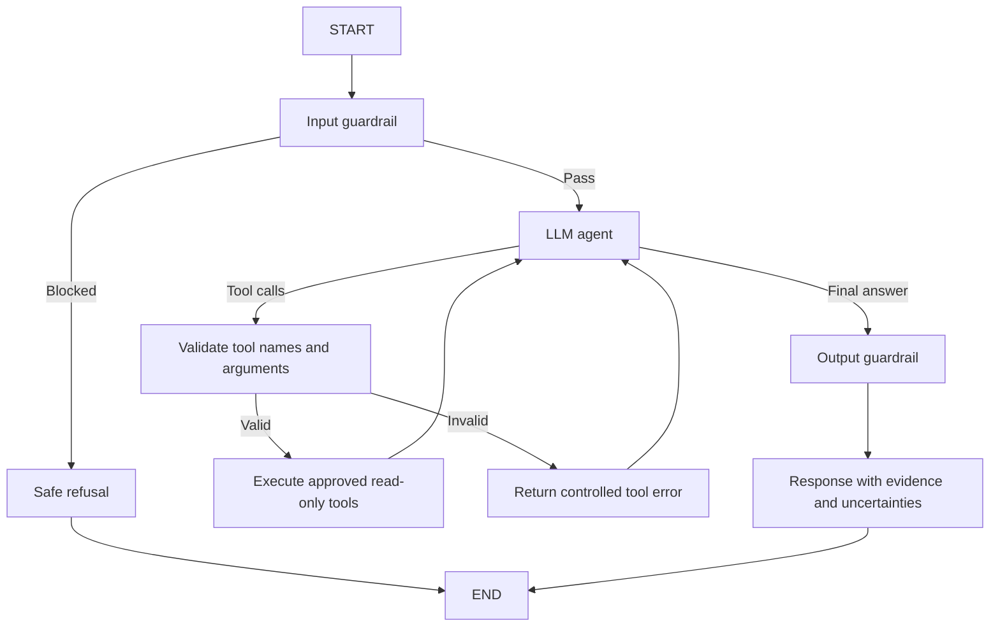

# LangGraph workflow (design)

State: `messages`, `run_id`, `iteration_count`, `source_refs`, `guardrail_flags`, `errors`.

Stop conditions: final LLM message without tool calls; max iterations reached; policy rejection; unrecoverable error.

Observability: a structured event for each node and tool invocation, durations and status.
